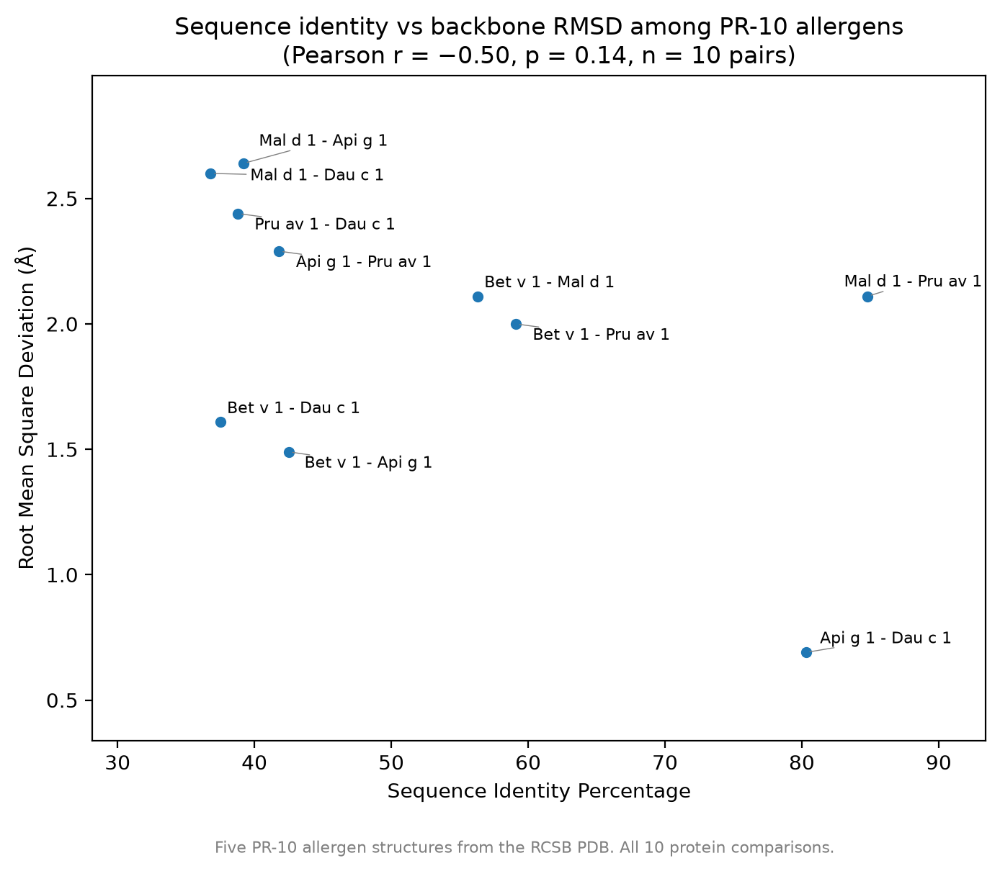

# PR-10 allergen comparison

Does sequence similarity predict structural similarity among PR-10 plant allergens?

This compares five PR-10 allergens pairwise — percent sequence identity against backbone
RMSD. Ten pairs show a weak negative trend that is not statistically significant, and the
Pearson correlation depends on a single pair, so the data cannot answer the question either way.



## Background

People with birch pollen allergy often react to raw apple, cherry, celery and carrot. The
reaction is usually limited to the mouth and lips, and it disappears when the food is cooked.
This is oral allergy syndrome (also called pollen-food allergy syndrome).

The cause is cross-reactivity. IgE antibodies raised against the birch pollen allergen
**Bet v 1** also bind structurally similar proteins in those foods. All of them belong to the
**PR-10** protein family and share the same fold.

The epitopes involved are **conformational**: the antibody recognises a patch of surface
residues that are far apart in the sequence but adjacent in the folded structure. That is why
cooking abolishes the reaction — heat unfolds the protein and the patch stops existing.

Because recognition depends on the folded surface rather than the sequence, sequence identity
may be a poor proxy for whether two allergens cross-react. This project tests how well the two
measures agree.

## Data

Five experimental structures from the RCSB PDB:

| PDB | Allergen | Source | Method |
|---|---|---|---|
| 1BV1 | Bet v 1 | birch pollen | X-ray |
| 5MMU | Mal d 1 | apple | NMR |
| 1E09 | Pru av 1 | cherry | NMR |
| 2BK0 | Api g 1 | celery | X-ray |
| 2WQL | Dau c 1 | carrot | X-ray |

## Method

For each of the 10 pairs:

1. Extract the amino acid sequence and the CA atoms of one chain (model 0).
2. Align the two sequences globally with **BLOSUM62**, gap open −11, gap extend −1.
3. Walk the aligned blocks to build two equal-length lists of paired CA atoms, one per
   aligned residue. Residues opposite a gap are excluded.
4. **Percent identity** = identical aligned pairs ÷ length of the shorter sequence × 100.
5. **RMSD** = superimpose the paired CA atoms (Biopython `Superimposer`) and take the
   root-mean-square deviation.

Method choices worth stating: identity is computed over the shorter sequence; the
superposition uses every aligned pair with no outlier pruning, so values are slightly higher
than tools that prune iteratively (e.g. ChimeraX `matchmaker`); where residues had alternate
conformations, the highest-occupancy position was used.

## Result

The full table is in [`allergen_comparison.csv`](allergen_comparison.csv).

| | Pearson r | p | Spearman ρ | p |
|---|---|---|---|---|
| all 10 pairs | −0.50 | 0.14 | −0.51 | 0.13 |
| without Api g 1 – Dau c 1 (celery/carrot) | −0.14 | 0.72 | −0.40 | 0.28 |

Higher identity goes with lower RMSD, but neither correlation is significant at n = 10.

Pearson assumes a straight-line relationship and is sensitive to extreme points; the
identity–RMSD relationship is known to be curved (Chothia & Lesk, 1986), so Spearman, which
uses ranks, is reported alongside it. Removing the celery/carrot pair collapses Pearson
(−0.50 → −0.14) but only weakens Spearman (−0.51 → −0.40): much of the Pearson trend comes from
that one extreme point.

Two pairs show the disagreement directly:

| Pair | Sequence identity | RMSD |
|---|---|---|
| Api g 1 – Dau c 1 (celery/carrot) | 80.3% | **0.69 Å** — most similar structure |
| Mal d 1 – Pru av 1 (apple/cherry) | **84.8%** — most similar sequence | 2.11 Å |

Both are high-identity pairs. They differ in method: celery/carrot is the only X-ray/X-ray
comparison, and apple/cherry are both NMR structures (see Limitations). So the gap between
them may come from the method, not the biology.

**Conclusion:** this dataset can neither show that sequence identity predicts structural
similarity nor that it fails to. Ten pairs from five proteins are too few to decide, and the
pairs are not independent: each protein appears in four of them.

## Limitations

- **Structure determination method is a confounder.** The lowest RMSD pair (celery/carrot) is
  the only X-ray/X-ray comparison. Every pair involving the NMR entries (apple, cherry) lands
  near 2 Å. NMR ensembles are systematically less tightly defined, so part of this spread is
  likely methodological rather than biological. Regenerating all five structures with
  AlphaFold would give one uniform method and test this.
- **Five proteins, one family, ten pairs.** A small sample.
- **No clinical data.** Even a clear identity–RMSD relationship would not show which measure
  predicts allergy. Validating that needs cross-reactivity rates from clinical studies.
- **One isoform each.** Bet v 1 in particular exists as many isoforms that differ in IgE
  reactivity, so these numbers describe specific isoforms, not the allergens in general.

## Next

- Leave-one-out: remove each pair in turn to see how much the correlation depends on any one.
- NMR ensembles: measure how much the models within one NMR file differ, compared with the
  differences between proteins.
- Scale up: the same comparison across every PR-10 structure in the PDB, with uncertainty
  estimated by resampling whole proteins rather than pairs.

Epitope-level analysis. `9Y0A` is a crystal structure of Bet v 1 bound to a human IgE Fab, so
the residues the antibody actually contacts can be measured rather than predicted. The question
is whether those specific positions are more conserved in the food allergens than the rest of
the protein is.

## Files

| File | |
|---|---|
| `allergen_functions.py` | the analysis functions |
| `data_creation.ipynb` | builds `allergen_comparison.csv` and `identity_vs_rmsd.png` from the PDB files |
| `figure.ipynb` | early plotting practice |
| `statistics.ipynb` | Pearson and Spearman correlations, with and without the celery/carrot pair |
| `pdb_files/` | the five structures, as downloaded |

## Running it

```
python3 -m venv .venv
source .venv/bin/activate
pip install biopython pandas scipy matplotlib seaborn adjustText jupyter
```

Then run `data_creation.ipynb`, then `statistics.ipynb`.

## Notes

Written by MS as a self-directed project.
